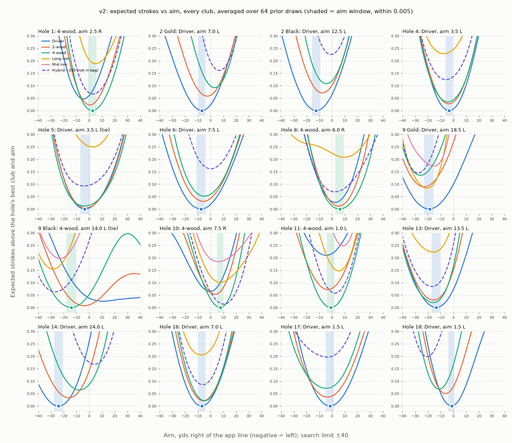

# Spirit Hollow tee strategy, v2: what changed, the evidence, and the verdict

Black tees, Spirit Hollow GC. Driver 275 / 2-wood 265 / 4-wood 255 carry (at 70°F), Long iron 210,
Mid iron 185, and a **hypothetical ~235 hybrid** (not in the bag; shown, never picked). Dispersion is
centred on 70 / 65 / 54 yds (95% lateral width). The live wind page and `output/final_decision.json`
are untouched. Everything here lives in `spirit_hollow/v2/`. Generated by `make_report.py` from
`output/v2_decisions.json` (GitHub Actions, 64 prior draws x 3,000 swings per hole),
`output/calibration.json` and `output/reverse_regret.json`.

## 1. What v2 changes (each one is a switch, so v1 can be reproduced)

| # | Area | v1 (live page) | v2 | Source / reason |
|---|---|---|---|---|
| 0 | Engine | `tee_strategy.simulate`: polygon test per shot and aim, 2.5-yd aim grid, search ±25 | Lie raster (0.5 yd) per map draw, so every aim on a 0.5-yd grid comes from one gather with the same swings (common random numbers). Aim is optimised continuously: 1-yd Gaussian smoothing of the **prior-averaged** curve, then Brent (bounded) on a cubic spline. Search ±40 (course.py's own `aim_min/aim_max`), with a flag if the optimum sits within 1 yd of the bound. | **Parity:** in v1's world the v2 engine reproduces `tee_strategy.simulate` to ≤ 0.007 strokes, with identical best aims (`test_v2.py::test_engine_reproduces_v1`). |
| 1 | Roll | "Soft" capped only the slope factor (×0.7-1.3). Driver still rolled ~25 yds (300 − 275, ×U(0.75, 1.2)). | 0.5-3.5 yds on fairway (×DEM slope factor, ±50% per swing), ×0.15-0.5 in rough | The golfer: the ball moves 1-2 yds after landing. **This is the largest single change.** |
| 2 | Temperature | none (carries are summer numbers) | carry × (1 − k·(70 − T)), k = 0.00075/°F (prior 0.0005-0.0009). That is about 2.1 yds per 10°F for the driver and 1.6 for a 210 iron. T = the forecast when you reach each hole (Sat 10 am tee, 14 min a hole: 44°F on 1, ~52°F on 18), ±3°F. The page interpolates grids at 35/45/55/65°F to each hole's forecast temperature. | Andrew Rice/TrackMan: 2-2.5 yds per 10°F (driver, 155 mph ball speed). TrackMan as reported: 1.3-1.7 by club. Titleist: ~1.5% per 20°F. |
| 3 | Club set | 3 woods; irons only on 11 and 13 | Driver, 2-wood, 4-wood, Long iron, Mid iron on every hole, plus the hypothetical hybrid (235/248, width 45×70/65, depth 22) | Brief + golfer request |
| 4 | Width ratios | The final run's prior used 2-wood/driver 0.94 and 4-wood/driver 0.85, i.e. 70 / **66 / 59.5**, not the stated 70/65/54 | 65/70 and 54/70 (LN sd 0.04 / 0.06) | Golfer's own 65:60:50. **A v1 inconsistency:** v1's 4-wood was ~10% wider than the golfer says. |
| 5 | Mishits | 10-20% of swings carry 92-97% of normal, same lateral | Slight: 8-16% carry 92-95% (5-8% short), lateral ×1.15. Heavy: 1-4% carry 65-85%, lateral ×1.5. | Robot tests of 2026 drivers: heel strikes cost 12-15 yds (~5%), toe ~5 yds. Review (REVIEW.md §3.7): no heavy-short tail in v1. |
| 6 | Correlated miss | none (RHO = 0 in the decision run) | Push-slice/pull-hook: corr(lateral, carry) ρ ~ U(−0.1, 0.3), positive = right misses shorter. Two-way curvature loss κ·(\|offline\| − E\|offline\|), κ ~ U(0, 0.16), centred so the stated carry stays the mean. Unknown aim bias N(0, 2 yds). | Curving shots lose carry; the published L/R split for a 5 hcp is symmetric (23/24%), so ρ and the bias are centred near 0. A one-way fade/draw is a sensitivity. |
| 7 | Lost ball / OB | 2 + rough at the landing distance | Stroke and distance: 1 + the hole's tee value (the tee shot is replayed). Lost-ball chance rises from 10-40% at the edge of the long grass to 50-80% 10 yds in (distance transform of the long-grass mask). | Rules of Golf 18.2. Broadie: S&D ≈ −2 SG. No published lost-ball rate exists, so it is graded and given a prior. |
| 8 | Water | 1 + rough at the landing spot | 1 + rough from where the ball **crossed into** the penalty area (walked back along the flight line) | Rule 17.1: red (lateral) and yellow relief both use that reference point |
| 9 | Trees | Broadie's tour "recovery" row (×severity) | Punch-out: 1 + next shot from 20-50 yds further on (fairway/rough mix) + 0-0.2 for a second recovery, with probability = severity U(0.6, 1). Otherwise a restricted shot from rough, +0-0.2. | Tour recovery costs ~0.85 vs fairway (ShotLink via GOLF). Amateurs advance less from a chip-out, and their punch-outs fail more often. |
| 10 | Line of sight | none | A ball in the open whose straight line to the green meets trees 10-60 yds ahead pays 20-60% of the punch-out cost | Doglegs (review: "straight-line distance ignores trees between ball and green") |
| 11 | Scoring table | PGA Tour (Broadie) | Scratch-5: tour fairway + 0.36 + (0.0006-0.0018)·(d − 150). The rough gap is ×0.55-0.95 of tour's and the sand gap ×0.9-1.3. First cut is 20-50% of the rough gap. | research.md: Stagner/Arccos (scratch 3.04 from 100 fw; a 5 at 100 = scratch at 150; 5-index rough +0.11 at 80-89 yds vs tour ~0.2), Shot Scope (bunker). Broadie's tables were re-checked: 100 fw 2.80, 160 2.98, 200 3.19; tee 400 3.99. |
| 12 | Unmapped ground | Untraced ground = rough | Untraced ground beyond the hand-checked ±55-yd corridor = "unverified": half rough, half trees, and the ball stops there | v2 run 1 (search ±60) "found" +60-yd aims on 9 Black and 18 that cut across unmapped ground, which the map scored as plain rough. See verdict. |

Prior: 64 scrambled-Sobol draws over 30 dimensions. Width is lognormal (median 70, 90% 62-80) with
width ratios as above. Carry: common N(0, 5) plus per-club N(0, 3). Depth window ×LN(1.25, 0.2). Also
drawn: soft roll, rough roll, trees, lost-ball edge/deep, mishit rates, ρ, κ, bias, temperature
offset and coefficient, rough/sand multipliers, distance slope, first cut, punch-out advance/failure,
line-of-sight severity, tree-restricted cost, and a map jitter (each polygon ±2.5 yds). Each draw uses
its own 3,000 swings, shared by all clubs and aims.

Decision rule: pick the real club with the lowest prior-averaged EV at its robust aim. Robust aim =
argmin of the **prior-averaged** curve, not the central draw's.

Par 5s and the next shot: the strokes-to-hole tables already price the next shot's lie, distance and
dispersion, including going for a par 5 or laying up (that is how the baseline is measured). The
amateur slope term makes each yard closer worth more than it is for a tour player.

## 2. Literature used this round (research.md has the rest)

* **Temperature:** Andrew Rice/TrackMan (GOLF 2018-19): ~2-2.5 yds per 10°F for driver; humidity
  negligible. Secondhand TrackMan figure: 1.33-1.66 yds per 10°F by club. Titleist: 1.5% per 20°F.
  [GOLF](https://golf.com/instruction/how-cooler-weather-impacts-golf-carry-distance/),
  [Golf News Net](https://thegolfnewsnet.com/golfnewsnetteam/2021/12/01/how-much-shorter-does-a-golf-ball-travel-in-cold-weather-124626/)
* **Mishit distance:** Golf Digest 2026 robot driver test: ¾-in toe strikes average about −5 yds,
  heel strikes −12 to −15 yds.
  [Golf Digest](https://www.golfdigest.com/story/drivers-2026-robotic-testing-data-gear-questions)
* **Recovery / tee-shot outcomes:** ShotLink via GOLF: tour recovery tee balls ~2.3% of drives, ~0.85
  strokes each; weekend golfers ~16% of tee shots into recovery.
  [GOLF](https://golf.com/instruction/the-pros-save-strokes-by-missing-tee-shots-in-the-right-places-you-can-too/)
* **First cut:** strokes-gained practice treats intermediate rough as near-fairway (Minton). At the 2017
  US Open the first cut cost ~½ stroke vs ¾ for the second.
  [Minton](https://apps.roanoke.edu/minton/SG%20Implement.html),
  [USGA](https://victory.usopen.com/2017/articles/strokes-gained-thru-36.html)
* **One-way vs two-way miss:** Titleist / Practical Golf forum: aim-off only pays for a reliable one-way
  shape, and good drivers miss about equally left and right. v2 therefore keeps a symmetric centre and
  tests a fade and a draw as sensitivities.
  [Titleist](https://www.titleist.eu/instruction/eliminate-one-side)
* **Broadie on amateur dispersion:** amateurs are about twice as wide in angle as tour players
  (Golfmetrics, 43k amateur shots). The per-group table could not be retrieved (columbia.edu is
  blocked here), so the 70-yd centre stays the golfer's own and 82 yds (σ ≈ 21, fitted in research.md
  to Shot Scope/Arccos 0-5 hcp data) is reported as a sensitivity.
* **Water relief, lost ball:** Rules 17.1 (reference = where the ball last crossed the edge) and 18.2
  (stroke and distance). Model Local Rule E-5 (2 strokes, fairway drop) costs within ~0.05 of S&D here.

## 3. Verdict

**v2 is better, and the v2 page is built** (`spirit_hollow/v2/wind_page/index.html`, to publish as a
NEW artifact). The reason is not that v2 scores better against outcome data. Neither model has the
golfer's own shot data to be scored against (see Calibration). It is better because:

1. **The engine is the same.** In v1's world it reproduces v1 to ≤ 0.007 strokes with the same best
   aims.
2. **It fixes inputs that contradict what we know:** the golfer's soft course, the golfer's own width
   ratios, the Rules on lost balls and water relief, the measured temperature, the DEM along the real
   Black-tee line, ground yards, and greens checked on NAIP.
3. **It fixes numerical problems:** v1's aims sat at its ±25 search bound, v1 had a 2.5-yd aim grid,
   and irons were offered on only 2 holes.

### Holes that change, and why (from the change ladder below)

* **6: 2-wood (tie) → Driver 7.5 L** (0.030, beats the 2-wood in 95% of worlds). Soft roll: v1 ran the
  driver ~25 yds on into the long-grass bands.
* **9 Gold: 2-wood → Driver 18.5 L** (0.083). Soft roll: v1's driver rolled into the creek/pond trouble
  right at ~300. Gold tee only.
* **10: Driver → 4-wood 7.5 R** (0.052, 92%). Two reasons. v1's Driver came from the final run's 4-wood
  width (59.5 instead of the golfer's 54): in v1's own world at 70/65/54 it is already a 4-wood
  (ladder step 0). The aim moves right because trees left block the line to the green on this par 5
  (line of sight +1 R → +8 R), and the Black-tee DEM cuts the driver's downhill bonus from +11 to +6 yds.
* **11: Long iron → 4-wood 1.0 L** (0.072, 89%). Soft roll: the creek is ~276-282 yds from the Black tee.
  v1 rolled the 4-wood 15+ yds toward it; on a soft course at 50°F it stops at ~253.
* **14: 2-wood at −25 (v1's search bound) → Driver 24 L** (0.033, 91%). Soft roll, plus v1 could not
  aim past −25, so its 2-wood/Driver aims were not optima.
* **18: 2-wood → Driver 1.5 L** (0.049, 92%). Soft roll: v1's driver ran ~25 yds on toward the creek
  past 300.
* **16: 4-wood (tie) → Driver 7.0 L** (0.020, 80%). Soft roll and the scratch-5 table; it reverts to the
  4-wood under the tour table or a pattern ≥ 86 yds. A lean, not a lock.
* **5: 4-wood → Driver 3.5 L, a tie** (0.004 vs 2-wood, +0.012 vs 4-wood). Any of the three woods; the
  4-wood is the pick at an 82-yd pattern or with v1's roll.
* **Aims only:** 2 Black 17.5 L → 12.5 L (the Black-tee DEM shortens the driver's downhill carry from
  +15 to +11 yds, so less to hold off the right; rules-based penalties). 13 10 L → 13.5 L. 17 2.5 R →
  1.5 L (trees on the line to the green). 9 Black 12.5 L → 14 L.
* **Unchanged:** 1 (4-wood), 2 Gold (Driver), 4 (Driver), 8 (4-wood, now only 0.012 over the 2-wood),
  9 Black (4-wood, a 0.007 tie with the 2-wood), 13 (Driver), 17 (Driver).

### Things that look wrong in v1

1. **Roll vs "soft".** The live page's model still rolls the driver ~25 yds (×0.7-1.3 slope cap only),
   although the golfer says the ball moves 1-2 yds. This is the biggest driver of club changes (6,
   9 Gold, 11, 14, 18; ladder step 2).
2. **Aims at the search bound.** Hole 14's 2-wood and Driver both sat at −25 (v1 searched ±25). The
   v1 driver aims on 11 and 9 Black sat at +25. The wind grid searched ±30 and its picks were never
   bound-checked.
3. **Width ratios.** final_decision.py's prior (prior_patch) centres 2-wood/4-wood at 0.94/0.85 of the
   driver, i.e. 70/66/59.5. That contradicts the stated 70/65/54 and is what makes v1 pick Driver on 10.
4. **Irons only on 11 and 13.** v1 never offered them anywhere else. They lose by ≥ 0.08 everywhere in
   v2, but that had not been checked.
5. **Lost ball / water pricing.** A lost ball was 2 + rough at the landing distance, not stroke and
   distance. Water used the landing distance, not where the ball crossed in.
6. **Geometry** (parity engineer, confirmed here):
   * Elevation was measured from the screenshot tee, up to 25 yds behind the Black tee. Driver carry
     bonus on 10: +11.2 → +6.0 yds; 2 Black +14.9 → +11.0; 14 +21.8 → +18.5.
   * App yards ≠ ground yards: the 270 dot is 261.5 ground yds on 6 (×0.968) and 276.5 on 16 (×1.024).
   * The app-trilaterated greens on 6 and 10 sit on the front edge of the green in NAIP, 15 and 11 yds
     from the OSM centre.

   These change one pick (13: 4-wood → Driver, already a 0.002 central-world tie) and move aims ≤ 2.5
   yds (2 Black, 6, 14, 16). See `output/geometry_check.json`.
7. **No temperature.** At 44-52°F the driver carries ~4 yds less than its 70°F number.
8. **Unmapped ground.** Both versions treat untraced ground as rough. With a wider search (v2 run 1) the
   optimiser aimed 60 yds right on 18 (across the creek to a strip traced as "fairway right of the
   creek") and on 9 Black (over the pond toward the creek and back yards, unmapped). v2 now limits aims
   to course.py's ±40 and scores untraced ground beyond the hand-checked ±55-yd corridor as half rough,
   half trees. **Worth checking on the course:** is the strip right of the creek on 18 playable from the
   Black tee? If it is, there is a second route the model cannot judge from this map.

### How much it matters, both ways

* **If v2's assumptions are right,** v1's club-and-aim choices cost **≈ 0.43 strokes per Black-tee round**
  (11 0.15, 10 0.07, 14 0.06, 18 0.05, 6 0.03, ...).
* **If v1's world is right** (25-yd roll, tour table), v2's choices cost ≈ 0.67 per round (11 0.17,
  14 0.17, 18 0.13, 9 Gold 0.07, 5 0.06).

So the choice between them is mostly the choice of **how far the ball runs**. The golfer reports a soft
course, hence v2. **On a firm day, use the "v1 roll" sensitivity column:** 5 → 4-wood, 11 → Long iron,
18 → 2-wood, the rest unchanged.

### Robustness

* **Aims:**
  * The robust (prior-averaged) aim is within 0.5 yd of the central-world aim on 14 of 16 holes
    (9 Black 2 yds, 14 1 yd).
  * Aim windows (within 0.005 strokes) are 4.5-8 yds wide.
  * No pick sits at a search bound.
  * Per-draw optimal aims spread 3-5 yds (SD), except 9 Black and 18, where single worlds jump between
    two routes (SD 20-30). The averaged curve still has one clear minimum there.
* **Monte Carlo:** swing noise is 0-4% of the variance of each margin. Cross-fitted margins equal the
  in-sample ones to 0.001 (no winner's curse).
* **Ties and leans:**
  * Ties (< 0.01): 5 (any wood), 9 Black (4-wood ≈ 2-wood).
  * Leans (0.01-0.025): 1, 8, 13, 16.
  * Everything else is ≥ 0.026 with P(beats runner-up) ≥ 83%.
* **Wider pattern (82 yds, the published 0-5 hcp fit):** 5 and 13 go to the 4-wood. Break-evens: 4 at
  82, 5 at 79, 13 at 78, 16 at 86, 1 (2-wood → 4-wood) at 63, 8 (2-wood → 4-wood) at 67.
* **Miss shape:** a one-way fade or draw (one tail 30% longer) moves aims 3-7 yds away from that side and
  changes only hole 5 (draw → 2-wood).
* **Temperature:** 35-65°F changes no central pick (margins move, e.g. 13 0.004 → 0.033). −8°F flips 8 to
  the 2-wood (a tie hole). The page uses each hole's forecast temperature.
* **Hypothetical ~235 hybrid:** never the play. Closest on 10 (+0.013 vs the 4-wood); elsewhere +0.06
  to +0.23. A gap club would not help these tee shots.
* **Par 5s:** going for it vs laying up is priced inside the scoring tables (expected strokes from
  the second shot's distance and lie). On 2 Black (Driver), 4 (Driver), 10 (4-wood) and 18 (Driver)
  the picks hold across every sensitivity, except 18 on a firm (v1-roll) day (→ 2-wood).

## Calibration (Driver at its best aim, mean of the 16 tee holes)

| World | Fairway | First cut | Penalty (water, OB, lost) | Trouble (penalty, trees, long grass) | Sand | > 40 yds offline |
|---|---|---|---|---|---|---|
| v1 world | 48% | 13% | 5.6% | 16% | 5.4% | 2.0% |
| v2 central | 60% | 21% | 4.3% | 9% | 1.9% | 2.5% |
| v2, width 82 | 54% | 21% | 5.4% | 13% | 1.9% | 5.8% |
| Published 0-5 hcp (research.md) | ~49% (Shot Scope, driver) | — | 1-3% (Shot Scope) | ~12% (Arccos scratch-4.9) | — | ~7% (Stagner) |

The golfer-stated 70-yd pattern makes the model straighter than published 0-5 handicap data (beyond-40 rate 2.5% vs ~7%); at an 82-yd pattern the tails match. Picks at 82 are in the sensitivity table. Fairway % runs high in every version: the soft course stops balls on the fairway, and published figures come from courses with roll.

## Reverse check

If v1's world (its central settings) were the truth, v2's plays would cost **0.67 strokes** per Black-tee round versus v1's own best plays. Per hole: 1 +0.014, 2B +0.000, 2F +0.013, 4 +0.000, 5 +0.063, 6 +0.009, 8 +0.004, 9B +0.072, 9F +0.013, 10 +0.040, 11 +0.169, 13 +0.005, 14 +0.167, 16 +0.036, 17 +0.006, 18 +0.134.

## Per hole: v1 (live page) vs v2

Aims in yds left (L) / right (R) of the app's line. v1 aim on a 2.5-yd grid, search ±25; v2 aim to 0.5 yd (Brent on the prior-averaged, smoothed curve), search ±40 (course.py limits). Aim window = every aim within 0.005 strokes of the best. Margin = expected strokes saved vs the runner-up club (± MC SE over 64 draws); cross-fitted = choose on half the draws, score on the other half.

| Hole | v1 pick, aim | v1 margin | v2 pick, aim | v2 aim window | v2 margin ± SE vs | cross-fit | P(beats runner) | change |
|---|---|---|---|---|---|---|---|---|
| 1 | 4-wood line | 0.060 vs 2W | **4-wood** 2.5 R | 0.5 L to 5.5 R | 0.022 ± 0.004 2W | 0.022 | 77% | — |
| 2 Gold | Driver 7.5 L | 0.048 vs 2W | **Driver** 7.0 L | 10.0 L to 4.0 L | 0.058 ± 0.004 2W | 0.058 | 95% | — |
| 2 Black | Driver 17.5 L | 0.082 vs 2W | **Driver** 12.5 L | 15.5 L to 9.0 L | 0.071 ± 0.005 2W | 0.071 | 95% | aim +5.0 |
| 4 | Driver 2.5 L | 0.047 vs 2W | **Driver** 3.5 L | 6.0 L to 0.5 L | 0.026 ± 0.003 2W | 0.026 | 83% | — |
| 5 | 4-wood 5.0 L | 0.012 vs 2W | **Driver** 3.5 L (tie) | 7.0 L to 0.5 R | 0.004 ± 0.002 2W | 0.004 | 58% | club |
| 6 | 2-wood 5.0 L (tie) | 0.010 vs 4W | **Driver** 7.5 L | 11.0 L to 4.0 L | 0.030 ± 0.002 2W | 0.031 | 95% | club |
| 8 | 4-wood 5.0 R | 0.046 vs 2W | **4-wood** 6.0 R | 2.5 R to 9.5 R | 0.012 ± 0.003 2W | 0.012 | 70% | — |
| 9 Gold | 2-wood 15.0 L | 0.013 vs 4W | **Driver** 18.5 L | 23.0 L to 15.5 L | 0.083 ± 0.011 LI | 0.083 | 84% | club |
| 9 Black | 4-wood 12.5 L | 0.063 vs 2W | **4-wood** 14.0 L (tie) | 18.0 L to 10.0 L | 0.007 ± 0.004 2W | 0.007 | 66% | — |
| 10 | Driver 5.0 L | 0.030 vs 4W | **4-wood** 7.5 R | 5.0 R to 10.0 R | 0.052 ± 0.004 2W | 0.053 | 92% | club |
| 11 | Long iron 2.5 R | 0.077 vs MI | **4-wood** 1.0 L | 4.0 L to 2.0 R | 0.072 ± 0.010 2W | 0.072 | 89% | club |
| 13 | Driver 10.0 L | 0.014 vs 4W | **Driver** 13.5 L | 17.0 L to 10.0 L | 0.020 ± 0.004 4W | 0.020 | 70% | aim -3.5 |
| 14 | 2-wood 25.0 L (tie) | 0.008 vs 4W | **Driver** 24.0 L | 27.5 L to 20.5 L | 0.033 ± 0.003 2W | 0.033 | 91% | club |
| 16 | 4-wood 5.0 L (tie) | 0.003 vs 2W | **Driver** 7.0 L | 10.0 L to 4.0 L | 0.020 ± 0.003 2W | 0.021 | 80% | club |
| 17 | Driver 2.5 R | 0.015 vs 2W | **Driver** 1.5 L | 5.0 L to 1.5 R | 0.035 ± 0.003 2W | 0.035 | 95% | aim -4.0 |
| 18 | 2-wood 5.0 L | 0.026 vs 4W | **Driver** 1.5 L | 4.0 L to 0.5 R | 0.049 ± 0.004 2W | 0.050 | 92% | club |

## Cost of playing v1's club and aim, scored by v2 (prior-averaged curves)

| Hole | v1 play | v2 play | strokes lost by v1 play |
|---|---|---|---|
| 1 | 4-wood line | 4-wood 2.5 R | +0.003 |
| 2 Gold | Driver 7.5 L | Driver 7.0 L | +0.000 |
| 2 Black | Driver 17.5 L | Driver 12.5 L | +0.011 |
| 4 | Driver 2.5 L | Driver 3.5 L | +0.000 |
| 5 | 4-wood 5.0 L | Driver 3.5 L | +0.012 |
| 6 | 2-wood 5.0 L | Driver 7.5 L | +0.031 |
| 8 | 4-wood 5.0 R | 4-wood 6.0 R | +0.000 |
| 9 Gold | 2-wood 15.0 L | Driver 18.5 L | +0.112 |
| 9 Black | 4-wood 12.5 L | 4-wood 14.0 L | +0.001 |
| 10 | Driver 5.0 L | 4-wood 7.5 R | +0.074 |
| 11 | Long iron 2.5 R | 4-wood 1.0 L | +0.152 |
| 13 | Driver 10.0 L | Driver 13.5 L | +0.005 |
| 14 | 2-wood 25.0 L | Driver 24.0 L | +0.063 |
| 16 | 4-wood 5.0 L | Driver 7.0 L | +0.021 |
| 17 | Driver 2.5 R | Driver 1.5 L | +0.007 |
| 18 | 2-wood 5.0 L | Driver 1.5 L | +0.050 |

Black-tee round (14 tee holes, Gold 2/9 excluded): v1's plays cost **0.43 strokes** per round under v2.

## Every club at its own robust aim (v2, prior-averaged EV; window in brackets)

| Hole | Driver | 2-wood | 4-wood | Long iron | Mid iron | Hybrid ~235 (not in bag) |
|---|---|---|---|---|---|---|
| 1 | 4.5 L [7.0 L, 2.0 L] +0.046 | 0.5 R [2.0 L, 3.0 R] +0.022 | **2.5 R [0.5 L, 5.5 R] 4.318** | 5.0 R [2.5 R, 8.0 R] +0.188 | 3.0 R [0.5 L, 7.0 R] +0.398 | 3.0 R [line, 6.0 R] +0.066 |
| 2 Gold | **7.0 L [10.0 L, 4.0 L] 5.503** | 2.5 L [5.5 L, 0.5 R] +0.058 | 3.0 R [0.5 R, 5.5 R] +0.091 | 19.0 R [16.5 R, 21.5 R] +0.396 | 36.5 R [35.0 R, 38.0 R] +0.741 | 7.0 R [4.5 R, 9.0 R] +0.160 |
| 2 Black | **12.5 L [15.5 L, 9.0 L] 4.954** | 8.0 L [10.5 L, 5.0 L] +0.071 | 4.5 L [7.0 L, 2.0 L] +0.107 | 3.5 R [1.5 R, 6.0 R] +0.361 | 8.5 R [6.0 R, 10.5 R] +0.468 | 1.0 L [3.5 L, 1.5 R] +0.225 |
| 4 | **3.5 L [6.0 L, 0.5 L] 5.217** | 3.5 L [6.5 L, 1.0 L] +0.026 | 4.5 L [7.5 L, 1.5 L] +0.034 | 7.5 L [11.5 L, 3.5 L] +0.228 | 9.0 L [13.0 L, 5.0 L] +0.326 | 6.0 L [9.5 L, 2.5 L] +0.124 |
| 5 | **3.5 L [7.0 L, 0.5 R] 4.253** | 2.5 L [6.5 L, 1.0 R] +0.004 | 3.5 L [8.0 L, 1.0 R] +0.012 | 2.5 R [1.0 L, 6.5 R] +0.249 | 6.5 R [4.0 R, 9.0 R] +0.421 | 4.0 L [9.0 L, 1.0 R] +0.093 |
| 6 | **7.5 L [11.0 L, 4.0 L] 4.326** | 5.5 L [9.0 L, 2.5 L] +0.031 | 5.0 L [8.5 L, 1.5 L] +0.051 | 4.5 R [1.5 R, 8.0 R] +0.313 | 5.0 R [2.0 R, 9.0 R] +0.469 | line [3.0 L, 3.5 R] +0.161 |
| 8 | 2.5 R [0.5 L, 5.5 R] +0.027 | 5.0 R [2.0 R, 8.0 R] +0.012 | **6.0 R [2.5 R, 9.5 R] 4.267** | 10.0 R [5.0 R, 14.5 R] +0.208 | 10.0 R [5.0 R, 15.0 R] +0.345 | 2.0 R [2.0 L, 6.5 R] +0.069 |
| 9 Gold | **18.5 L [23.0 L, 15.5 L] 4.461** | 23.0 L [26.5 L, 19.5 L] +0.089 | 25.5 L [28.5 L, 23.0 L] +0.135 | 20.5 L [23.5 L, 18.0 L] +0.083 | 15.5 L [18.5 L, 12.5 L] +0.172 | 27.5 L [30.0 L, 25.5 L] +0.144 |
| 9 Black | 11.0 R [4.5 R, 19.5 R] +0.025 | 4.0 L [8.5 L, 0.5 R] +0.007 | **14.0 L [18.0 L, 10.0 L] 4.334** | 28.5 L [31.0 L, 25.5 L] +0.154 | 23.0 L [26.0 L, 20.0 L] +0.196 | 26.5 L [30.5 L, 23.0 L] +0.063 |
| 10 | 0.5 L [3.5 L, 2.5 R] +0.064 | 3.5 R [1.0 R, 6.0 R] +0.052 | **7.5 R [5.0 R, 10.0 R] 5.214** | 7.5 R [4.5 R, 11.5 R] +0.101 | 6.0 R [2.0 R, 10.5 R] +0.184 | 10.5 R [7.5 R, 13.5 R] +0.013 |
| 11 | 4.5 L [8.0 L, 1.0 L] +0.209 | 3.5 L [6.5 L, line] +0.072 | **1.0 L [4.0 L, 2.0 R] 4.150** | 5.5 R [3.0 R, 7.5 R] +0.147 | 8.5 R [6.5 R, 10.5 R] +0.247 | 2.5 R [0.5 L, 5.0 R] +0.058 |
| 13 | **13.5 L [17.0 L, 10.0 L] 4.386** | 15.5 L [19.0 L, 12.5 L] +0.030 | 16.0 L [19.0 L, 13.0 L] +0.020 | 16.0 L [19.5 L, 12.5 L] +0.223 | 12.0 L [17.0 L, 8.5 L] +0.381 | 17.0 L [20.0 L, 13.5 L] +0.084 |
| 14 | **24.0 L [27.5 L, 20.5 L] 4.234** | 16.0 L [19.5 L, 12.5 L] +0.033 | 8.0 L [11.0 L, 4.0 L] +0.064 | 16.0 R [13.0 R, 18.5 R] +0.319 | 24.5 R [22.0 R, 28.0 R] +0.535 | 4.0 R [1.0 R, 7.0 R] +0.167 |
| 16 | **7.0 L [10.0 L, 4.0 L] 4.295** | 5.5 L [8.5 L, 3.0 L] +0.020 | 4.5 L [7.5 L, 2.0 L] +0.021 | 7.5 L [10.5 L, 4.0 L] +0.205 | 6.5 L [13.5 L, 0.5 L] +0.426 | 6.0 L [9.0 L, 3.5 L] +0.085 |
| 17 | **1.5 L [5.0 L, 1.5 R] 4.514** | 3.5 L [7.5 L, line] +0.035 | 4.5 L [9.0 L, 0.5 L] +0.071 | 1.0 L [7.5 L, 4.0 R] +0.374 | 1.0 R [6.5 L, 6.5 R] +0.550 | 4.0 L [9.0 L, 0.5 R] +0.197 |
| 18 | **1.5 L [4.0 L, 0.5 R] 5.112** | 6.5 L [8.5 L, 4.0 L] +0.049 | 11.0 L [13.5 L, 9.0 L] +0.068 | 40.0 R [40.0 R, 40.0 R] +0.343 ⚠ | 40.0 R [40.0 R, 40.0 R] +0.323 ⚠ | 20.5 L [23.0 L, 18.5 L] +0.197 |

## Change ladder (central world): pick / aim after each change, cumulative from v1's world

| Hole | 0 | 1 | 2 | 3 | 4 | 5 | 6 | 7 | 8 | 9 |
|---|---|---|---|---|---|---|---|---|---|---|
| 1 | 4W 0.5 L | 4W 0.5 L | 4W 2.5 R | 4W 3.0 R | 4W 3.5 R | 4W 3.5 R | 4W 3.0 R | 4W 3.0 R | 4W 3.0 R | 4W 3.0 R |
| 2 Gold | D 8.5 L | D 8.5 L | D 8.5 L | D 6.0 L | D 6.0 L | D 5.0 L | D 6.5 L | D 7.5 L | D 5.5 L | D 7.5 L |
| 2 Black | D 16.5 L | D 16.5 L | D 15.5 L | D 13.5 L | D 13.0 L | D 13.0 L | D 11.0 L | D 12.0 L | D 11.5 L | D 12.5 L |
| 4 | D 4.0 L | D 4.0 L | D 4.0 L | D 4.0 L | D 4.0 L | D 4.0 L | D 3.5 L | D 4.0 L | D 4.0 L | D 3.5 L |
| 5 | 4W 4.5 L | 4W 4.5 L | 4W 4.0 L | 2W 2.0 L | 2W 1.5 L | 2W 1.5 L | 2W 2.0 L | 2W 2.0 L | 2W 2.0 L | D 3.0 L |
| 6 | 2W 7.0 L | 2W 7.0 L | D 9.0 L | D 7.5 L | D 6.5 L | D 6.5 L | D 7.0 L | D 6.5 L | D 6.5 L | D 7.5 L |
| 8 | 4W 5.0 R | 4W 5.0 R | 4W 5.5 R | 4W 5.5 R | 4W 5.5 R | 4W 6.0 R | 4W 6.0 R | 4W 6.0 R | 4W 6.0 R | 4W 5.5 R |
| 9 Gold | 2W 14.5 L | 2W 14.5 L | D 13.5 L | D 14.0 L | D 14.5 L | D 15.5 L | D 15.0 L | D 15.0 L | D 18.5 L | D 18.0 L |
| 9 Black | 4W 9.5 L | 4W 9.5 L | 2W 9.0 L | 2W 10.0 L | 2W 11.0 L | 2W 10.5 L | 2W 10.5 L | 4W 13.0 L | 4W 13.5 L | 4W 12.0 L |
| 10 | 4W 1.5 R | 4W 1.5 R | 4W 0.5 R | 4W 0.5 R | 4W 0.5 R | 4W 1.0 R | 4W line | 4W 1.0 R | 4W 8.0 R | 4W 7.5 R |
| 11 | LI 1.0 R | LI 1.0 R | 4W 1.5 L | 4W 1.0 L | 4W 1.0 L | 4W 0.5 L | 4W 0.5 L | 4W 1.0 L | 4W 0.5 L | 4W 1.0 L |
| 13 | D 10.5 L | D 10.5 L | D 9.5 L | D 11.0 L | D 11.5 L | D 12.5 L | 4W 16.0 L | 4W 16.0 L | 4W 16.0 L | D 13.0 L |
| 14 | 4W 15.5 L | 4W 15.5 L | D 26.0 L | D 23.0 L | D 22.5 L | D 22.5 L | D 22.0 L | D 21.5 L | D 21.5 L | D 23.0 L |
| 16 | 4W 4.5 L | 4W 4.5 L | D 7.0 L | D 6.5 L | D 6.0 L | D 6.0 L | D 6.5 L | 4W 5.0 L | 4W 5.0 L | D 7.0 L |
| 17 | D 2.0 R | D 2.0 R | D 2.5 R | D 2.5 R | D 2.5 R | D 2.5 R | D 2.0 R | D 2.0 R | D 1.5 L | D 1.0 L |
| 18 | 4W 7.5 L | 4W 7.5 L | D 0.5 L | D 3.0 L | D 2.0 L | D 2.0 L | D 2.5 L | D 2.0 L | D 2.0 L | D 1.5 L |

Steps: 0 = v1 world (v2 engine, v1 clubs); 1 = + irons on every hole; 2 = + soft course: 0.5-3.5 yd roll; 3 = + forecast temperature at the hole; 4 = + mishits 5-8% short (+ 2.5% heavy); 5 = + correlated miss (rho, curvature loss); 6 = + penalty rules (S&D, water entry, graded lost ball); 7 = + punch-out tree cost; 8 = + trees blocking the line to the green; 9 = + scratch-5 amateur scoring table (= v2 central).

## Sensitivities (central world, N = 12,000): pick / aim

| Hole | central | width 82 (published 5-hcp average) | width 60 (tighter) | v1-final width ratios (70/66/59.5) | PGA Tour scoring table | v1 roll (~25 yds driver) | no heavy mishits | fade: right tail 30% longer | draw: left tail 30% longer | no line-of-sight cost | 70°F | forecast -8°F (colder) | lost ball rare (10-40%) | lost ball likely (40-90%) | trees always chip-out |
|---|---|---|---|---|---|---|---|---|---|---|---|---|---|---|---|
| 1 | 4W 3.0 R | 4W 4.0 R | **2W line** | **2W 2.0 R** | 4W 3.0 R | 4W line | 4W 3.0 R | 4W 1.0 L | 4W 7.0 R | 4W 3.0 R | 4W 2.0 R | 4W 3.0 R | 4W 2.5 R | 4W 3.5 R | 4W 3.0 R |
| 2 Gold | D 7.5 L | D 7.5 L | D 7.5 L | D 7.5 L | D 5.5 L | D 8.5 L | D 7.5 L | D 9.5 L | D 4.5 L | D 9.0 L | D 8.5 L | D 6.5 L | D 7.5 L | D 6.5 L | D 7.5 L |
| 2 Black | D 12.5 L | D 11.0 L | D 13.0 L | D 12.5 L | D 11.5 L | D 15.0 L | D 13.5 L | D 15.0 L | D 8.5 L | D 13.0 L | D 15.5 L | D 12.0 L | D 12.5 L | D 13.0 L | D 12.5 L |
| 4 | D 3.5 L | D 2.5 L | D 3.5 L | D 3.5 L | D 4.0 L | D 3.5 L | D 3.5 L | D 6.5 L | D 0.5 R | D 3.5 L | D 3.5 L | D 3.5 L | D 3.0 L | D 3.5 L | D 3.5 L |
| 5 | D 3.0 L | **4W 2.0 L** | D 5.0 L | D 3.0 L | **2W 2.0 L** | **4W 4.5 L** | D 3.0 L | D 8.0 L | **2W 3.5 R** | D 3.0 L | **2W 2.5 L** | D 2.5 L | D 3.5 L | D 2.5 L | D 3.0 L |
| 6 | D 7.5 L | D 6.5 L | D 10.0 L | D 7.5 L | D 6.5 L | D 9.5 L | D 8.0 L | D 11.5 L | D 3.5 L | D 7.5 L | D 9.0 L | D 7.5 L | D 8.0 L | D 7.0 L | D 7.0 L |
| 8 | 4W 5.5 R | 4W 7.0 R | **2W 5.0 R** | **2W 5.0 R** | 4W 6.0 R | 4W 4.5 R | 4W 5.5 R | 4W 1.0 R | 4W 11.0 R | 4W 5.5 R | 4W 5.5 R | **2W 5.0 R** | **2W 4.5 R** | 4W 5.5 R | 4W 5.5 R |
| 9 Gold | D 18.0 L | D 17.0 L | D 17.5 L | D 18.0 L | D 18.5 L | D 9.0 L | D 17.5 L | D 21.0 L | D 14.0 L | D 13.5 L | D 14.5 L | D 18.0 L | D 17.5 L | D 18.0 L | D 17.5 L |
| 9 Black | 4W 12.0 L | 4W 12.0 L | 4W 11.5 L | 4W 12.5 L | 4W 13.5 L | 4W 3.5 L | 4W 12.0 L | 4W 15.5 L | 4W 8.5 L | **D 5.0 L** | 4W 10.0 L | 4W 12.5 L | 4W 12.0 L | 4W 12.0 L | 4W 12.0 L |
| 10 | 4W 7.5 R | 4W 7.0 R | 4W 9.0 R | 4W 7.5 R | 4W 8.0 R | 4W 7.0 R | 4W 7.5 R | 4W 6.0 R | 4W 9.5 R | 4W 0.5 R | 4W 7.0 R | 4W 8.0 R | 4W 7.5 R | 4W 7.5 R | 4W 7.5 R |
| 11 | 4W 1.0 L | 4W 0.5 L | 4W 0.5 L | 4W 1.0 L | 4W 0.5 L | **LI 4.5 R** | 4W 1.5 L | 4W 4.0 L | 4W 2.5 R | 4W 1.5 L | 4W 2.0 L | 4W 1.0 L | 4W 1.0 L | 4W 1.0 L | 4W 1.0 L |
| 13 | D 13.0 L | **4W 16.5 L** | D 11.5 L | D 13.0 L | **4W 16.0 L** | D 13.5 L | D 13.0 L | D 19.0 L | D 9.0 L | D 13.0 L | D 11.0 L | D 13.0 L | D 13.0 L | D 13.0 L | D 12.5 L |
| 14 | D 23.0 L | D 24.5 L | D 23.5 L | D 23.0 L | D 21.5 L | D 32.0 L | D 23.0 L | D 27.5 L | D 18.5 L | D 23.0 L | D 25.5 L | D 22.0 L | D 22.0 L | D 23.5 L | D 22.0 L |
| 16 | D 7.0 L | D 5.5 L | D 7.0 L | D 7.0 L | **4W 5.0 L** | D 8.0 L | D 7.0 L | D 10.0 L | D 3.0 L | D 6.5 L | D 7.5 L | D 6.5 L | D 7.5 L | D 6.5 L | D 7.5 L |
| 17 | D 1.0 L | D 0.5 L | D 2.0 L | D 1.0 L | D 1.5 L | D line | D 1.0 L | D 5.5 L | D 3.0 R | D 2.5 R | D line | D 1.5 L | D 1.5 L | D 0.5 L | D 1.0 L |
| 18 | D 1.5 L | D 0.5 R | D 3.0 L | D 1.5 L | D 2.0 L | **2W 4.0 L** | D 1.5 L | D 3.5 L | D 1.5 R | D 1.5 L | D 0.5 R | D 2.5 L | D 1.0 L | D 2.0 L | D 1.5 L |

Bold = a different club from the v2 central world.

## Common-width break-evens (v2 central world; all clubs scale together)

| Hole | 55 | 60 | 65 | 70 | 75 | 80 | 85 | 90 | flips |
|---|---|---|---|---|---|---|---|---|---|
| 1 | 2W | 2W | 4W | 4W | 4W | 4W | 4W | 4W | 2-wood→4-wood at 63 |
| 2 Gold | D | D | D | D | D | D | D | D | none |
| 2 Black | D | D | D | D | D | D | D | D | none |
| 4 | D | D | D | D | D | D | 4W | 4W | Driver→4-wood at 82 |
| 5 | D | D | D | D | D | 4W | 4W | 4W | Driver→4-wood at 79 |
| 6 | D | D | D | D | D | D | D | D | none |
| 8 | 2W | 2W | 2W | 4W | 4W | 4W | 4W | 4W | 2-wood→4-wood at 67 |
| 9 Gold | D | D | D | D | D | D | D | D | none |
| 9 Black | 4W | 4W | 4W | 4W | 4W | 4W | 4W | 4W | none |
| 10 | 4W | 4W | 4W | 4W | 4W | 4W | 4W | 4W | none |
| 11 | 4W | 4W | 4W | 4W | 4W | 4W | 4W | 4W | none |
| 13 | D | D | D | D | D | 4W | 4W | 4W | Driver→4-wood at 78 |
| 14 | D | D | D | D | D | D | D | D | none |
| 16 | D | D | D | D | D | D | D | 4W | Driver→4-wood at 86 |
| 17 | D | D | D | D | D | D | D | D | none |
| 18 | D | D | D | D | D | D | D | D | none |
